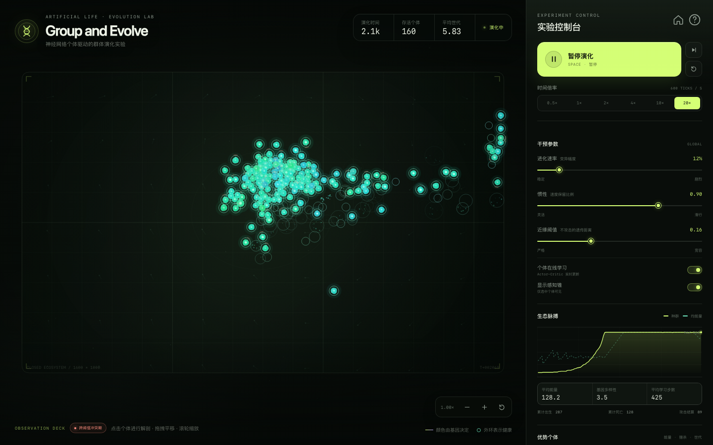
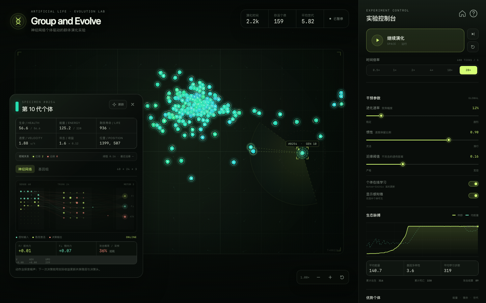

# Group and Evolve

一个可直接在浏览器中运行的人工生命演化实验。生态从**一个生产者型始祖细胞**开始，通过不断分裂、遗传变异和个体内学习扩张。个体之间没有被预先分类：不存在预分类 ID、阵营或身份标签；任意两者的关系只由它们的六个性状基因差异决定。颜色也是基因参数的连续函数，而不是任何分类或阵营的配色。

不需要安装依赖，也不需要构建。






## 运行

项目包含一个项目主页和独立的模拟器页面：

- `index.html`：项目主页，包含实验介绍、机制、流程、观察窗入口与制作署名。
- `simulator.html`：完整的交互式演化模拟器。

直接打开 `index.html`，点击“进入实验”进入模拟器；模拟器左侧栏的返回按钮或顶部品牌可直接回到主页。也可以启动一个本地静态服务器：

```bash
cd "group and evolve"
python3 -m http.server 8000
# 浏览器访问 http://127.0.0.1:8000
```

推荐使用较新的 Chrome、Safari 或 Edge。页面使用 Canvas 2D、Pointer Events、ResizeObserver 等标准 Web API，无外部字体与网络请求。

模拟器会把种子写入 URL（例如 `simulator.html?seed=20251018`），刷新后可以复现同一轮演化。实验参数保存在浏览器的 `localStorage` 中。

## 快速操作

| 操作 | 说明 |
| --- | --- |
| `Space` | 运行 / 暂停 |
| `S` | 单步推进一个时间单位 |
| `R` | 用新种子从单一起点重新开始 |
| `Shift + R` 或 `Shift + 点击重置` | 沿用当前种子复现实验 |
| `V` | 显示 / 隐藏选中个体的感知锥与两两关系连线 |
| `L` | 开启 / 暂停个体在线学习 |
| `Esc` | 关闭个体解剖或帮助面板 |
| 点击个体 | 打开个体解剖面板 |
| 拖拽 / 滚轮 | 平移 / 缩放生态视窗 |
| 点击底部 `SEED` 芯片 | 复制当前实验种子 |

侧栏可以滚动，包含参数、生态曲线、优势个体与事件流。点击“跟踪”可让视窗跟随选中个体。

## 模拟模型

### 生产者型单细胞起点

每次重置只创建一个**始祖细胞**，生态最初没有多个个体，也没有预设分类。始祖能量低于繁殖阈值，通常会在最初几十个时间单位内完成第一次分裂；随后种群逐渐逼近 160 的容量上限。

始祖是**生产者型**生命，其基准基因组刻意偏向自养、低掠食策略（随后代变异而改变）：

| 始祖基准性状 | 初始值 | 含义 |
| --- | --- | --- |
| 攻击伤害 | 1.8 | 接近下限 1.5，攻击能力很弱 |
| 攻击收益 | 0.125 | 接近下限 0.12，掠食几乎无利可图 |
| 自然能量增长 | 0.39 /t | 接近上限 0.42，依赖环境能量 |
| 繁殖阈值 | 57 E | 接近下限 55，能量足够就尝试分裂 |
| 繁殖成功率 | 32% | 单次成功率偏低，需要多次尝试 |
| 质量 | 1.04 | 普通体型 |

每次播种会围绕这些基准值加入很小的种子相关抖动。所有值都可被遗传变异改变，因此生产者后代完全可能演化成高伤害、高掠夺收益的捕食策略。

### 遗传距离与攻击关系

六个性状基因先按各自范围归一化到 `[0, 1]`。两名个体 `a`、`b` 之间的遗传距离是：

```text
d(a, b) = sqrt( (1/6) · Σᵢ ((gᵢᵃ - gᵢᵇ) / (maxᵢ - minᵢ))² )
```

`d = 0` 表示六个性状完全一致，`d = 1` 表示都位于取值范围的两端。

- **近缘保护**：若 `d ≤ τ`，这对个体互不攻击。攻击目标搜索会直接排除对方，属于硬性规则。
- **攻击资格**：若 `d > τ`，这对个体才可能互相攻击；是否真的出手仍由神经网络决定。
- `τ` 是界面中的**近缘阈值**，默认 `0.16`，可在 `0–0.50` 之间调整。降低阈值会扩大可攻击对象范围；提高阈值会让生态更和平。
- 没有分类 ID、阵营或成员列表，也没有基于身份的攻击判定。每次攻击都重新检查该攻击者与该候选目标之间的实际遗传距离。

### 颜色：基因的连续表型

身体颜色不是身份标签，而是**直接从该个体的六个基因计算**出的连续表型：

- 攻击伤害与攻击收益共同映射到暖色/红色分量；
- 自然能量增长映射到绿色分量；
- 繁殖阈值与繁殖成功率映射到蓝紫分量；
- 质量会影响视觉上的亮度与体型。

因此，两名个体的基因越接近，颜色通常也越接近；不存在“同样的基因被分到不同颜色”的分类跳变。为了让轻微的基因漂移也能被看见，显示层会对色相差异做一个固定的线性增强；它不会产生离散分组，也不参与攻击判定。颜色相近并不等于属于同一类别，不同颜色也不必然敌对——攻击是否发生完全由实际两两遗传距离决定。

颜色是从六维基因空间投影到可见色彩空间的低维表示，并不是基因组的唯一编码；不同的罕见组合可能得到相近的颜色。这不会改变攻击关系，因为攻击判定始终使用精确的基因距离，而不是颜色。

### 时间与运动

一次 `step()` 等于一个单位时间。默认 `30 ticks/s × 时间倍率`；`4×` 时为 120 ticks/s。个体速度先乘全局惯性，再叠加上神经力产生的加速度，以及环境微流：

```text
v' = v · I + (F / m) · κ + flow
p' = p + v'
```

- `I`：全局惯性，界面范围 0.70–0.97。
- `F`：神经网络输出的二维持续力，分解为自身前向与侧向两个分量。
- `m`：个体质量。同样的力作用在更大的个体上，加速度更小。
- `flow`：缓慢变化的环境流场，使生态系统始终有可见运动。
- 轻微的体积排斥避免个体完全重叠，但不参与遗传或学习规则。

### 个体数据与基因

每个个体记录位置、速度、生命值、剩余寿命、能量，以及六个可遗传性状：

| 性状 | 范围 | 作用 |
| --- | --- | --- |
| 攻击伤害 | 1.5–12 | 每次攻击对目标造成的生命损失 |
| 攻击收益 | 0.12–0.95 | 从目标处转移能量的比例 |
| 质量 | 0.55–2.6 | 决定加速度、体型、最大生命与寿命 |
| 自然能量增长 | 0.045–0.42 /t | 每个时间单位自动增加的能量 |
| 繁殖阈值 | 55–155 E | 能量达到该值后尝试繁殖；越低繁殖越快 |
| 繁殖成功率 | 8%–95% | 每次繁殖尝试成功生成子代的概率 |

> 需求中的“繁殖速度”在本实现里对应能量阈值。阈值越低，达到繁殖条件越快。高阈值个体通常有更多能量储备，因此两种策略各有取舍。

最大生命与寿命由质量派生。能量上限为 220，幸存个体会把能量投入增殖；死亡后从生态中删除。

### 感知

个体以当前运动方向为前方，在 **142° 感知锥、255 单位距离**内检测最近的 **6 个其他个体**。

输入向量保持 **60 维**：

- **18 维自身状态**：偏置、能量、生命比例、剩余寿命、速度、质量、攻击伤害、攻击收益、繁殖阈值、繁殖成功率、攻击冷却、四个方向的边界距离、视野内个体数、**视野内近缘比例**、能量/繁殖阈值。
- **6 × 7 维邻居状态**：前向距离、侧向距离、前向相对速度、侧向相对速度、目标生命比例、**随阈值变化的遗传亲和信号**、目标质量。

遗传亲和信号在 `d ≤ τ` 时为正（越接近 1 越相似），越过阈值后转为负值。因此网络能感知每个对象与自身的遗传距离，而不依赖任何分类标签。

不可见邻居的槽位填 0。每个输入都做了归一化或截断。

### 神经网络

```text
60 输入 → 24 tanh 隐层 → 3 输出
                          ├─ F∥  前向力
                          ├─ F⊥  侧向力
                          └─ 攻击 logit
```

- 力输出经过 `tanh`，并以局部坐标系表示；个体转向时力也随之旋转。
- 攻击输出经 sigmoid 得到概率，再采样为“攻击 / 巡航”。
- 推力和攻击动作都带有探索噪声（σ = 0.18），因此网络是随机策略，而非确定性映射。
- 网络每次决策时也会用当前状态估计价值 `V(s)`。
- 死亡时使用终局更新，不再自举下一状态价值。

实现是一个两层 MLP 的手写前向与反向传播，权重存放在 `Float32Array` 中。攻击决策先经过两两遗传距离门控：附近只有近缘个体时，即使网络输出较高的攻击概率，攻击也会被抑制，并在个体面板中显示“近缘抑制”。

### 两层学习

这套实验同时运行两个时间尺度：

1. **生命内学习：在线 Actor-Critic**  
   每个时间步，个体用上一步动作实际获得的奖励，更新网络共享隐层、两个力输出头、攻击头和价值头。
   奖励来自掠夺能量、造成伤害、成功繁殖、受伤、被杀和死亡等结果。采用一步延迟更新：新状态的价值用于计算上一动作的优势函数。遗传亲和信号进入感知后，网络可以在生命过程中学习与不同基因距离个体相关的运动策略。

2. **世代间学习：遗传 + 变异**  
   繁殖时，子代复制父代**当前**（经过在线学习后的）网络权重和全部基因。之后每个参数按全局进化速率发生概率性高斯变异，偶尔出现大幅跳变。权重被限制在稳定范围内，防止数值爆炸。

因此界面里同时能看到：

- 一个个体一生中的策略变化（在线学习步数、价值、优势、近缘抑制）；
- 跨世代的行为变化（是否更善于攻击、繁殖或生存）；
- 颜色随基因漂移连续变化，而不是随某个分组标签跳变。

### 繁殖

每个时间步：

1. 能量自然增长；
2. 若能量达到繁殖阈值、繁殖冷却结束、且种群未达上限，则按成功率尝试一次；
3. 成功时父代扣除繁殖能量，产生带变异子代，并进入较长的繁殖不应期；
4. 失败只消耗时间，并进入较短的不应期。

种群上限为 160，用于保证浏览器实时仿真性能。

### 攻击

- 只有神经网络采样出“攻击”时才会尝试攻击。
- 候选目标必须通过**两两遗传距离门控**：只有与该个体遗传距离 **大于** 近缘阈值的对象才可被选中。
- 目标还必须在 **118° 前方攻击扇形**和 **100 + 双方半径**的距离内。
- 攻击有 18 个时间单位的冷却，并消耗少量能量。
- 目标失去生命，能量按 `min(目标能量, 伤害 × 攻击收益)` 转移给攻击者。
- 目标生命归零时死亡；攻击者获得一次猎杀计数和额外学习奖励。
- 第一次成功的跨阈值攻击会触发“首次跨阈值攻击”事件并切换生态阶段。

## 指标与控制

- **顶部统计**：演化时间、存活个体、平均世代和运行状态。
- **阶段标签**：生产者期 → 遗传分化期 → 跨阈值冲突期。
- **生态脉搏**：种群与平均能量历史曲线。曲线每 15 个时间单位采样一次。
- **基因多样性**：六个基因在种群中的平均归一化标准差。
- **平均学习步数**：存活个体自出生后完成的在线 Actor-Critic 更新次数均值。
- **近缘阈值**：控制“不攻击”的遗传距离上限。调整后会立即影响攻击资格与感知中的遗传亲和信号。暂停时调整也会刷新感知。
- **个体解剖 · 视域关系**：显示选中个体视野中的近缘/远缘数量、最近远缘距离与当前阈值。
- **感知锥与关系连线**：选中个体时，绿色虚线连接阈值内近缘个体，珊瑚色连线连接阈值外远缘个体。
- **优势个体**：按能量、猎杀和世代排序的前四名；点击可定位并打开解剖。
- **事件流**：出生、首次跨阈值攻击、自然死亡、猎杀与生态事件。高频事件会按时间节流。
- **在线学习开关**：关闭后网络权重冻结，只有遗传变异继续作用，可用于 A/B 对照。
- **感知可视化开关**：只影响选中个体的感知锥和关系连线，不影响神经网络实际输入。

## 文件结构

```text
.
├── index.html          # 项目主页
├── simulator.html      # 交互式模拟器页面
├── home.css            # 主页视觉系统与响应式布局
├── styles.css          # 模拟器视觉系统与响应式布局
├── js/
│   ├── home.js         # 主页 Hero 培养皿动画与导航交互
│   ├── utils.js        # 随机数、插值、格式化等工具
│   ├── brain.js        # 60→24→3 网络、变异与 Actor-Critic 更新
│   ├── simulation.js   # 生态、感知、遗传距离、颜色映射、物理与统计
│   ├── renderer.js     # Canvas 渲染、相机、拾取、关系连线与粒子
│   └── app.js          # 主循环、控制、图表、个体解剖、事件流
├── assets/
│   ├── homepage.png    # 主页预览
│   ├── ecosystem.png   # 主页观察窗与模拟器预览
│   └── inspector.png   # 个体解剖预览
└── README.md
```

模拟器脚本按顺序以经典 `<script>` 加载，共享 `window.Evo` 命名空间；主页使用独立的 `home.css` / `home.js`。两页都不依赖服务器，因此在 `file://` 下也能直接运行。

## 浏览器控制台实验接口

页面暴露了一个小型调试入口：

```js
GroupAndEvolve.tick
GroupAndEvolve.population
GroupAndEvolve.simulation.getTelemetry()
GroupAndEvolve.simulation.getLeaders(10)
GroupAndEvolve.simulation.setSettings({ nearThreshold: 0.14 })
GroupAndEvolve.simulation.refreshPerception()
GroupAndEvolve.renderer.getZoom()
Evo.genomeColor(creature.genes)       // 查看基因到颜色的连续映射
Evo.geneticDistance(creatureA.genomeVector, creatureB.genomeVector)
```

注意：`setSettings()` 会即时改变实验规则；若要干净地比较两组阈值，建议固定种子后重新播种。修改内部个体或网络权重可能使统计与渲染状态不一致。这是实验接口，不是稳定 API。

## 参数与默认值

- 始祖类型：**生产者型**（低攻击、极低掠食收益、高自然增能、低繁殖阈值、偏低成功率）。
- 默认全局进化速率：**12%**（`DEFAULT_EVOLUTION_RATE`）。
- 默认近缘阈值：**0.16**（`DEFAULT_NEAR_THRESHOLD`）。
- 默认时间步率：**30 ticks/s**；时间倍率为 `0.5× / 1× / 2× / 4× / 10× / 20×`。
- 默认惯性：**0.90**。
- 初始个体数：**1**。
- 种群上限：**160**。

调节位置：

- 物理、感知、攻击范围、冷却、环境流强度：`js/simulation.js` 顶部的 `PHYSICS`。
- 默认近缘阈值、进化速率、种群上限、时间步率、能量上限：`js/simulation.js` 顶部常量。
- 基因范围与名称：`js/simulation.js` 的 `GENE_DEFINITIONS`。
- 初始始祖基因组：`js/simulation.js` 的 `ANCESTOR_GENOME`。
- 基因到颜色的映射：`js/simulation.js` 的 `genomeColor()` / `rgbToHsl()`。
- 网络拓扑、探索噪声、学习率、折扣因子：`js/brain.js`。
- 视觉主题、布局、颜色：`styles.css`。

修改输入维度或拓扑时，需要同步修改 `js/simulation.js` 中的 `_sense()` 输入组装、`js/brain.js` 的 `INPUT_SIZE / HIDDEN_SIZE`，以及 `js/app.js` 的网络图布局。

## 模型边界

这是一个用于观察涌现行为的交互式实验，不是经过同行评审的生态学模型：

- 近缘判断被抽象为六个性状基因上的欧氏距离，不是真实基因组或亲缘系数。
- 颜色是六维基因空间到三维可见色彩的连续投影，不包含全部遗传信息；不同基因型可能得到相近颜色。颜色绝不参与攻击判定。
- 不存在预分类、阵营、物种或身份 ID。所有关系都是每次按个体对独立计算的。
- 攻击门控只阻止特定个体对之间的攻击；没有实现亲代抚育、群体协作、集体防御、配偶选择或疾病传播。
- 在线学习不保证单调提升适应度；探索噪声、环境流和小种群漂移都会导致策略波动甚至灭绝。
- 灭绝是合法结果。可用重新播种开始新实验，或开启新种子做对照。
- 所有行为由随机过程驱动；固定种子（URL 参数）可以复现同一初始状态，但显示层的粒子使用了独立的非确定性随机数。

## 性能说明

一个 160 个体的生态系统在 1× 下目标为 30 ticks/s，4× 下为 120 ticks/s，10× / 20× 的目标为 300 / 600 ticks/s。渲染使用单个 Canvas 2D 上下文，并对设备像素比做上限为 2 的截断。

高倍率主要受浏览器主线程的实体仿真与在线学习开销限制。在当前实现中，若生态达到 160 个体，普通设备上实际吞吐可能停在约 300 ticks/s 左右，因此 **20× 在高密度状态下不一定能达到名义的 20 倍速度**；在个体较少、仿真较便宜时更接近目标。界面中的 ticks/s 是当前时间倍率对应的目标值。

低性能设备上可：

- 降低时间倍率；
- 关闭在线学习以节省反向传播开销；
- 通过 `GroupAndEvolve.simulation.maxPopulation` 降低种群上限（仅对之后的运行生效）；
- 缩小窗口尺寸。

界面未使用任何第三方库、CDN、字体请求或遥测。

## 项目主页

主页参考现代产品落地页结构，提供 Hero 培养皿动效、实验内核、演化流程、模拟器观察窗、FAQ 和进入实验的入口。主页与模拟器相互链接；页面页脚与模拟器侧栏均标注了 **帧流工作室制作**，并链接至 <https://www.ffstudio.site/>。
